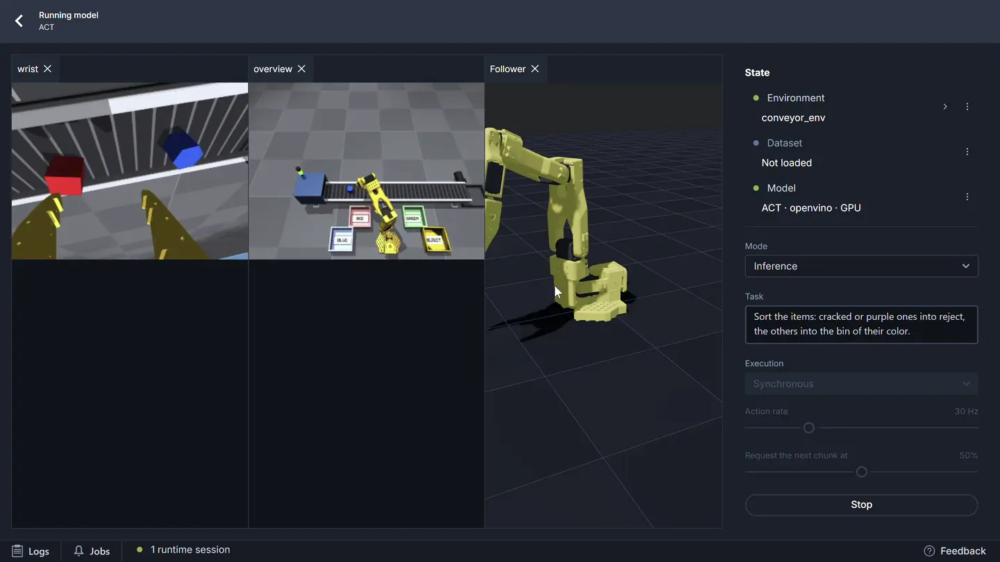
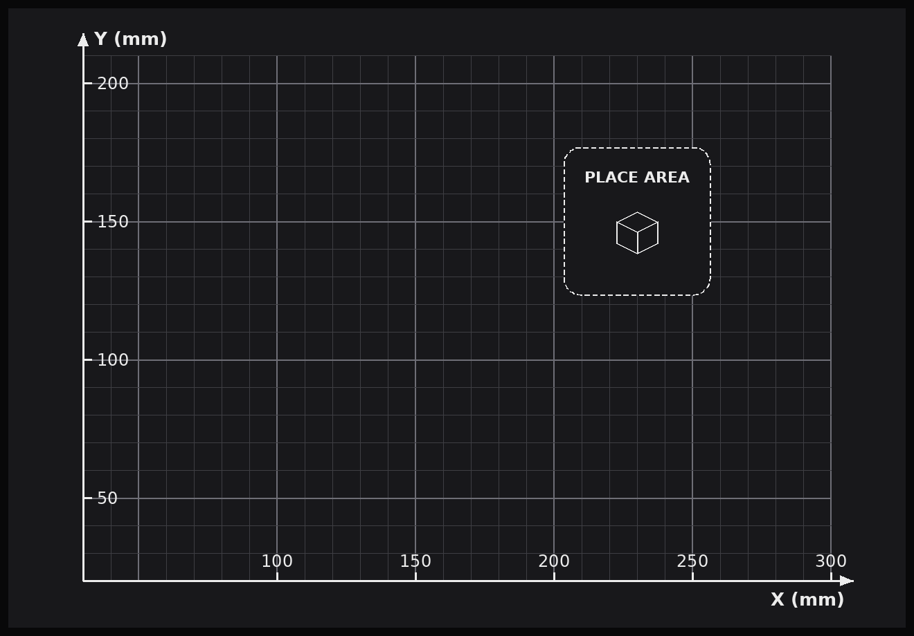
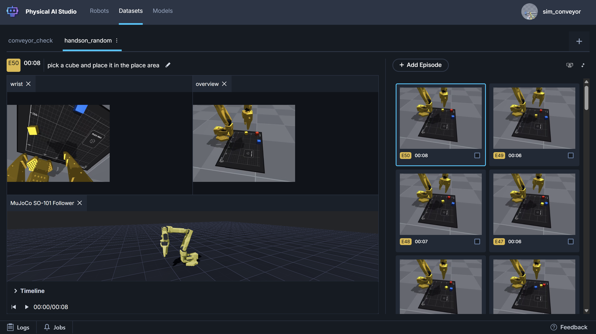

# Hands-on: Physical AI Studio — Simulation Reproduction

> **Unofficial.** Personal notes. This is not official Intel documentation; see the [Physical AI Studio repository](https://github.com/open-edge-platform/physical-ai-studio) for that.

I reproduce the Physical AI Studio hands-on session from Intel AI Summit Seoul 2026 in simulation only, without robot hardware, by implementing the cube pick-and-place task myself.

Details of the original session (time, room, presenter, table setup) are in [SESSION.md](SESSION.md).

## Implementation

**Setup:** Galaxy Book6 Pro (Intel Core Ultra X7 358H, Arc B390, NPU, 32 GB), WSL2 Ubuntu 24.04, Physical AI Studio with the MuJoCo plugin. No robot hardware: every episode comes from a scripted demonstrator.

### Milestones

| # | Milestone | What to do | Done when | Status |
|---|---|---|---|---|
| M0 | Environment | Install uv, Node.js 24, git, and ffmpeg in WSL2 Ubuntu 24.04; clone `physical-ai-studio` and `physicalai` | Tool versions confirmed | ✅ |
| M1 | Simulator check | Install the MuJoCo plugin and start the SO-101 in the `single_pick_place` scene | Cameras near 30 fps and real-time factor near 1.00x in the browser viewer | ✅ |
| M2 | Studio connection | Run Studio; add the MuJoCo follower, virtual leader, and two IP cameras; record a few `conveyor_sort` episodes, train ACT briefly, and run the model. Check whether the iGPU (XPU) is used for training | The whole GUI workflow runs end to end | ✅ |
| M3 | Cube demonstrator (drive mode) | Write a pick-and-place demonstrator in `sim-reproduction/` that reuses the plugin's SO-101 IK and hooks in through a launcher, without editing the plugin; test it in drive mode | 90%+ success over 20 trials, with the cube respawned at a random position after each success | ✅ |
| M4 | Hands-on scene | Build the session's task scene: blue, red, and yellow cubes and a square PLACE AREA on the table; have the demonstrator move one cube per episode; test it in drive mode | 90%+ success over 20 trials in the hands-on scene | ✅ |
| M5 | Recording | Record the training set in Studio with **Start episode** → **Accept**, as at the session: about 50 episodes, each moving one cube picked at random, with the demonstrator as a virtual leader. Include deliberate failures with recovery: **(A) missed grasp**, closing beside the cube and then grasping again; **(B) drop during the carry**, a shallow grasp that slips and a new pick where the cube lands | Episodes saved and replayable in a dataset; the three colours about equally often; failure rate, failure kinds, and seed set at launch | ✅ |
| M6 | Training and run | Train ACT on the M5 dataset on the iGPU (XPU), export to OpenVINO, run the model in Studio, and measure it with the episode judge | Success rate measured | ⬜ |
| M7 | Write-up | Put code, configs, and results (success-rate table, videos) in `sim-reproduction/` and this README | Reproduction steps and results documented | ⬜ |

The scope is the hands-on session itself: the same scene, one cube picked and placed per episode, recording with **Start episode** → **Accept**, ACT training, and running the model ([SESSION.md](SESSION.md)). Two additions come from the presenter's advice at the session: recording recoveries on purpose (M5) and a dataset large enough to see whether ACT finishes the task (M5, M6). The presenter's staged curriculum (distractors, then several place positions) is out of scope.

One episode picks one cube and places it in the PLACE AREA. As at the session, where people picked any cube, the cube is chosen at random each episode, whatever its position, and the three colours come up equally often. ACT reads only the camera images and joints, not the task text, so it cannot tell which cube an episode means; whether it still learns to place a cube is part of what M6 measures. A deliberate failure and its recovery stay inside the same episode; failures go into about 10–20% of episodes, at most one per episode, so most demonstrations stay clean. The cube positions are randomized each episode.

### Environment (M0–M2)

The versions installed and checked in M0–M2, on 2026-11-14 and 15. The setup script will pin the same versions.

| Component | Version | Set up in |
|---|---|---|
| OS | WSL2, Ubuntu 24.04.5 LTS | M0 |
| Python | 3.13.18 (via uv 0.13.8) | M0 |
| Node.js / npm | v24.22.3 / 11.19.1 | M0 |
| git / git-lfs | 2.43.0 / 3.4.1 | M0 |
| ffmpeg | 6.1.1 | M0 |
| [physical-ai-studio](https://github.com/open-edge-platform/physical-ai-studio) | commit `8f1324161ece2b24f2d38765b6e943ed1961258c` | M0 |
| [physicalai](https://github.com/openvinotoolkit/physicalai) | commit `0ec06e9f38ac69170f391cf8343d83f7c6081668` | M0 |
| MuJoCo plugin (from the `physicalai` commit) | plugin 0.5.1.dev27, physicalai 0.4.1.dev7, MuJoCo 3.16.0, OpenVINO 2026.4.1 | M1 |
| Studio backend (`uv sync --extra xpu --extra sim-e2e`) | physicalai-studio 0.3.0, PyTorch 2.11.0+xpu, MuJoCo plugin 0.5.0 | M2 |
| Intel GPU compute runtime (`ppa:kobuk-team/intel-graphics`) | libze-intel-gpu1 / intel-opencl-icd 26.40, IGC 2.42.14 | M2 |
| WSL memory (`%USERPROFILE%\.wslconfig`) | `memory=22GB`, `swap=16GB` | M2 |

### M1 result

The SO-101 ran in the `single_pick_place` scene at a real-time factor of 1.00x with 50 Hz control. Mesa in WSL renders on the CPU (llvmpipe) by default; with `export GALLIUM_DRIVER=d3d12` in `~/.bashrc`, MuJoCo renders on the Arc B390 (D3D12, OpenGL 4.6), and the two cameras reach 26.8 fps on AC power (about 22 fps on battery), above Studio's 24 fps floor. If the browser viewer at `http://127.0.0.1:9090` stays blank on Windows, an ad blocker that filters localhost traffic (AdGuard's "Filter localhost" option) can be the cause.

### M2 result

<p align="center">
  
  <br>
  <em>Run model in Studio: ACT · OpenVINO · GPU (Inference mode) on the MuJoCo SO-101 in the <code>conveyor_sort</code> scene.</em>
</p>

ACT trained on the iGPU (XPU) for 1 epoch on 3 `conveyor_sort` episodes in 6 min 9 s, then ran in simulation with OpenVINO on the GPU. As in the hands-on session, the undertrained model moves toward the items but cannot grasp them.

### M3 result

The scripted demonstrator ([`sim-reproduction/`](sim-reproduction/)) placed the cube on the target disc in **20 of 20 trials (100%)** in drive mode, with no failed grasps, drops, or timeouts. After each success the plugin respawned the cube at a random position, and the plugin's own episode auto-reset (cube resting on the disc for 5 s) judged every success.

| File | Role |
|---|---|
| `pick_place_demo.py` | The demonstrator: a phase machine (approach, descend, close, lift, carry, lower, release, rise) that reads the cube and target poses from the simulation and reuses the plugin's SO-101 `ArmIK` |
| `pick_place_sim.py` | Hooks the demonstrator into the plugin without editing it. The plugin builds the robot in a separate owner process from its exported `class_path`, so the hook is an importable `MuJoCoRobot` subclass |
| `run_sim.py` | Starts the simulation with the hook; same command line as `physicalai-mujoco` |
| `eval_drive.py` | Turns on drive mode and reports the success rate from `/health` |

```bash
cd ~/work/physicalai
uv run --no-sync python ~/intel-ai-summit-seoul-2026/hands-on/sim-reproduction/run_sim.py start --scene single_pick_place
# in a second terminal
python3 ~/intel-ai-summit-seoul-2026/hands-on/sim-reproduction/eval_drive.py --trials 20
```

### M4 result

<p align="center">
  
  <br>
  <em>The simulated work mat, with ticks to X 300 and Y 200 mm as on the session mat. The arm stands below the X axis at X = 100 mm, facing +Y.</em>
</p>

The hands-on scene, `handson_pick_place`, copies the session's table: blue, red, and yellow 2 cm cubes and a square PLACE AREA on a work mat with a millimetre grid. Each episode the demonstrator picks one of the three cubes at random. In drive mode it moved that cube into the PLACE AREA in **20 of 20 trials (100%)**; an episode judge in the scene counted each success and then reset the cubes to random positions.

```bash
cd ~/work/physicalai
uv run --no-sync python ~/intel-ai-summit-seoul-2026/hands-on/sim-reproduction/run_sim.py start --scene handson_pick_place
# in a second terminal
python3 ~/intel-ai-summit-seoul-2026/hands-on/sim-reproduction/eval_drive.py --trials 20
```

Before restarting the simulation, turn off **Teleoperate** in Studio and run `pkill -f _owner_worker`: the simulation's owner process can outlive `Ctrl+C`, and a new start then fails with `no state received from owner`.

### M5 result

<p align="center">
  
  <br>
  <em>The <code>handson_random</code> dataset in Studio, with the task text <code>pick a cube and place it in the place area</code>; each episode holds the wrist and overview video and the follower's joints.</em>
</p>

Studio recorded **50 episodes** into the dataset `handson_random` with **Start episode** → **Accept**, as at the session, under the task text `pick a cube and place it in the place area`. Each episode moved one cube picked at random: 16 red, 17 blue, 17 yellow. 44 were clean and 6 (12%) had a deliberate failure with recovery, 3 missed grasps and 3 drops during the carry; every episode ended with its cube in the PLACE AREA. A demonstration took 4.5–7 s and a recorded episode about 6–8 s, and the 50 took about 10 minutes to record. The demonstrator acted as the leader arm (autopilot `leader` mode, read by Studio's MuJoCo Virtual Leader), and `record_helper.py` reset the scene, ran each demonstration and told when to click.

```bash
cd ~/work/physicalai
HANDSON_FAILURE_RATE=0.15 HANDSON_SEED=1 uv run --no-sync python ~/intel-ai-summit-seoul-2026/hands-on/sim-reproduction/run_sim.py start --scene handson_pick_place
# start Studio, create the dataset, open the recording view and turn on Teleoperate, then:
python3 ~/intel-ai-summit-seoul-2026/hands-on/sim-reproduction/record_helper.py --episodes 50
```
