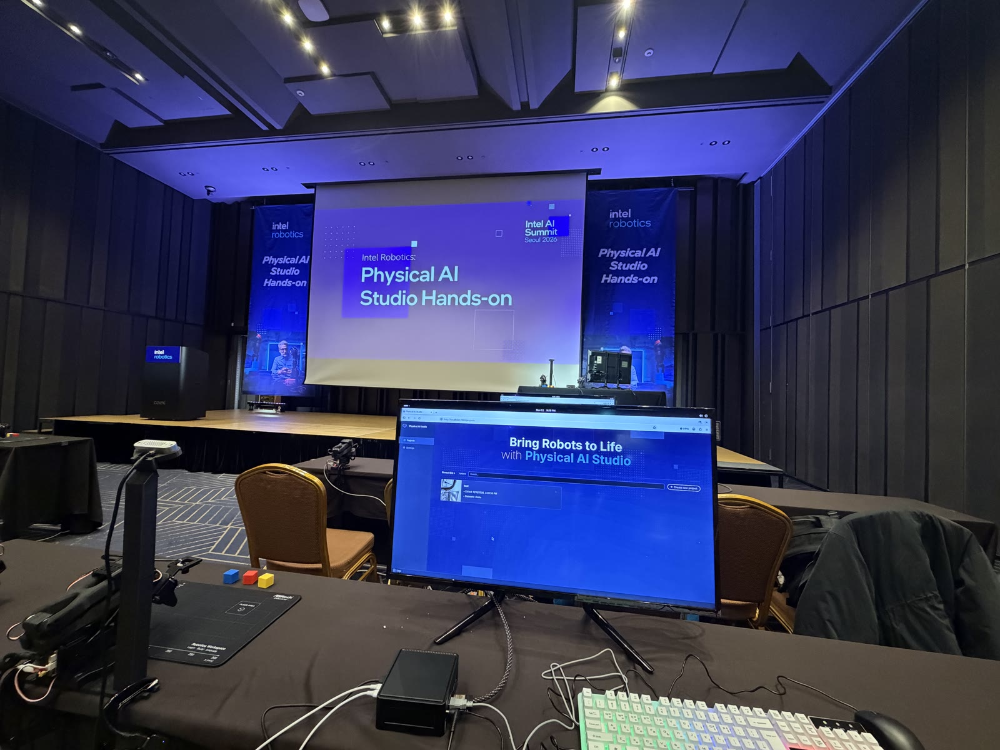
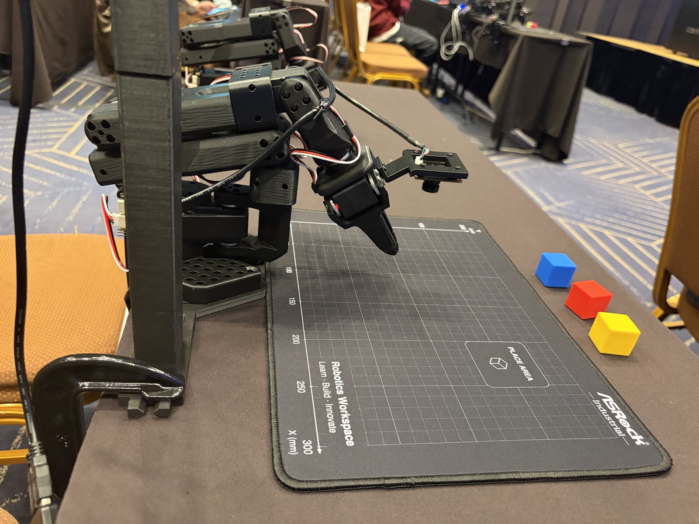
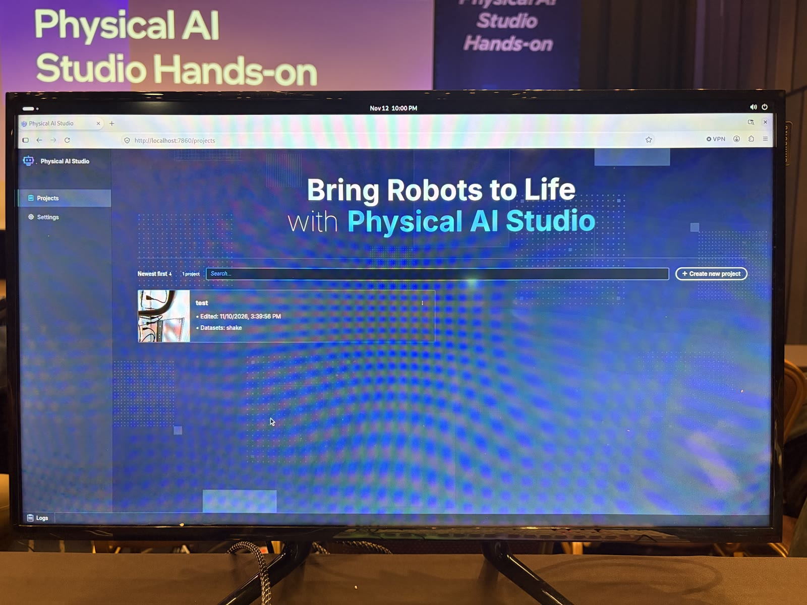
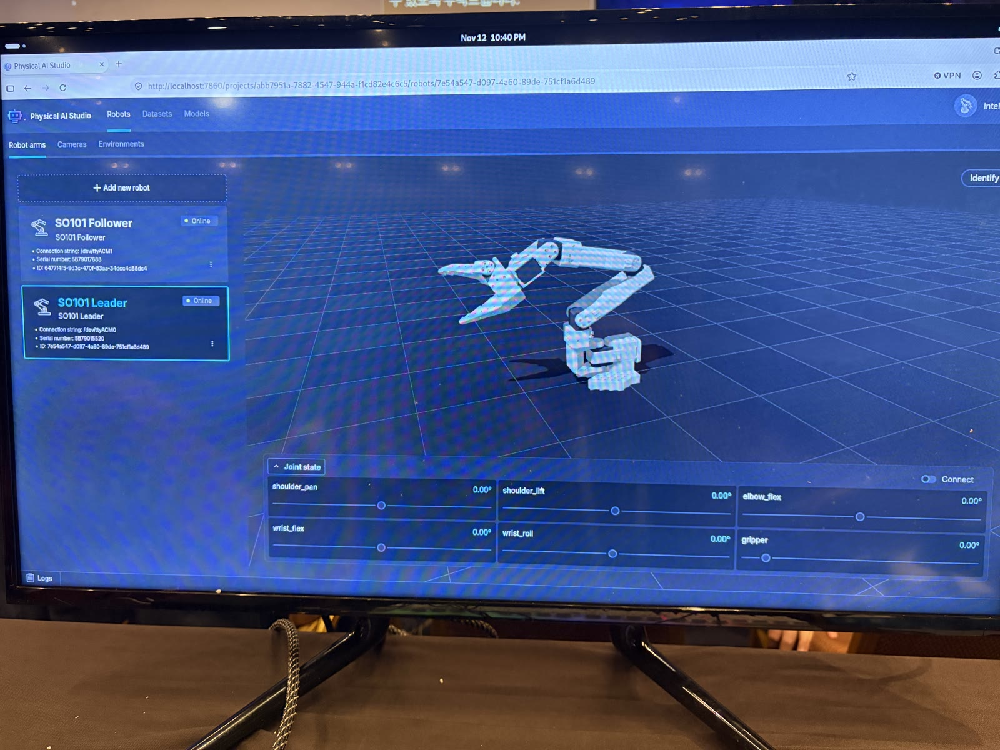
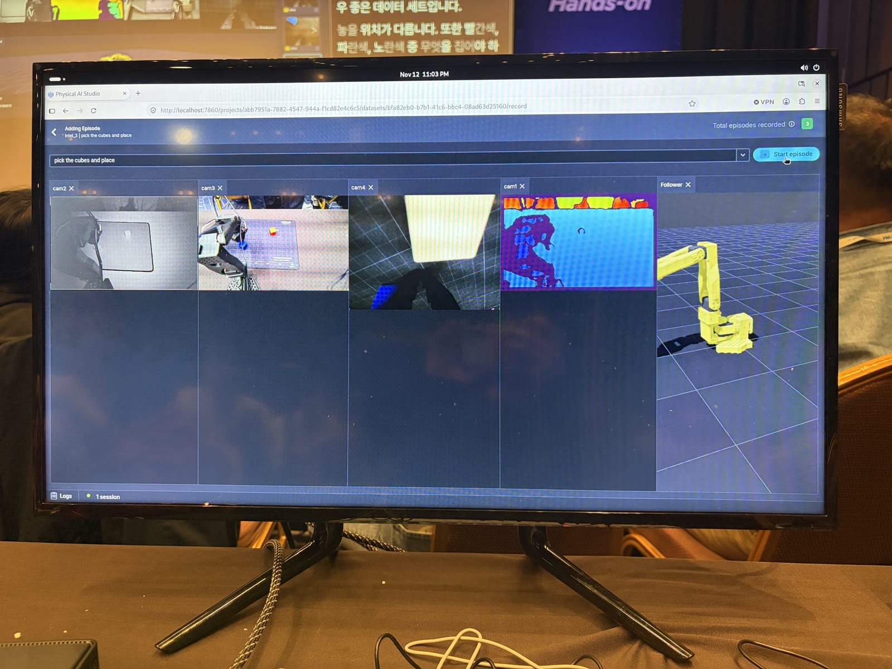
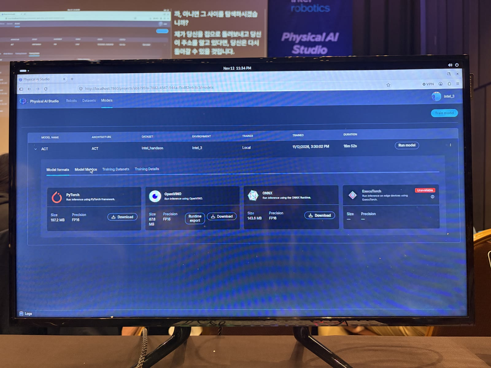
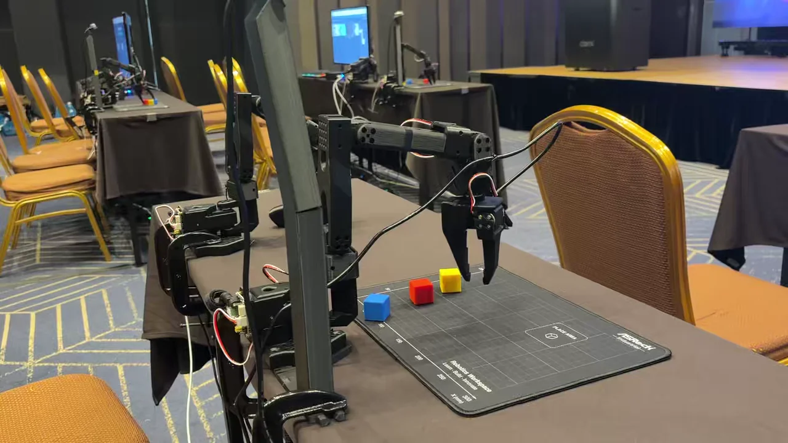

# Hands-on Session Recap

What we did in the original hands-on session at the summit. My own simulation reproduction is in [README.md](README.md).

## Session

  
   
  <em>The hands-on room. Each attendee table had a NUC, a monitor, an SO-101 leader and follower, a depth camera on a stand, and the cube task mat.</em>

| Item | Details |
|---|---|
| Title | Intel Robotics: Physical AI Studio Hands-on |
| Date / time | 2026-11-12, 15:20 – 16:40 |
| Room | COEX 1F, Grand Ballroom 101 |
| Presenter | Jeevan Thakare (Intel) |
| Format | Presenter-led, step by step |
| Support staff | Four staff helped at the tables: three English-speaking and one Korean-speaking |

## Table setup

  
   
  <em>The task setup: the SO-101 follower with a wrist camera, the depth camera stand, and the blue, red, and yellow cubes.</em>

| Item | Details |
|---|---|
| Computer | ASRock Industrial NUC BOX-358H (NUC Ultra 300 BOX series; Intel Core Ultra X7 358H, Panther Lake, 32 GB) |
| OS / app | Linux, Physical AI Studio served at `localhost:7860` |
| Robots | SO-101 leader (with handle) + SO-101 follower (with wrist camera and gripper) |
| Cameras | One depth camera on a stand (depth, IR, and RGB streams) + one USB camera on the follower's wrist |
| Task props | Blue, red, and yellow cubes on a "Robotics Workspace" mat with a marked **PLACE AREA** |

## Physical AI Studio during the session

| | |
|---|---|
|  |  |
| **Projects** — the start page | **Robot arms** — SO-101 follower and leader added |
|  |  |
| **Recording** — four camera feeds, the follower's 3D model, and the task text | **Models** — the trained ACT model and its export formats |

### How it went

1. Each table set up the project, the SO-101 leader and follower, the four camera feeds, and the environment by following the presenter.
2. Episodes were recorded in pairs: one person clicked **Start episode** and **Accept** in Studio, while the other moved the leader arm with both hands to pick one cube and place it in the PLACE AREA.
3. Each person recorded about two episodes, so each table ended up with only a few episodes.
4. ACT was trained locally on the NUC for only 100 steps so it would finish within the session.
5. The trained model was run on the follower. With so few episodes and steps, it moved toward the cubes but did not complete the pick-and-place.

  
   
  <em>The undertrained ACT policy running on the follower: it moves over the cubes but does not finish the task.</em>

